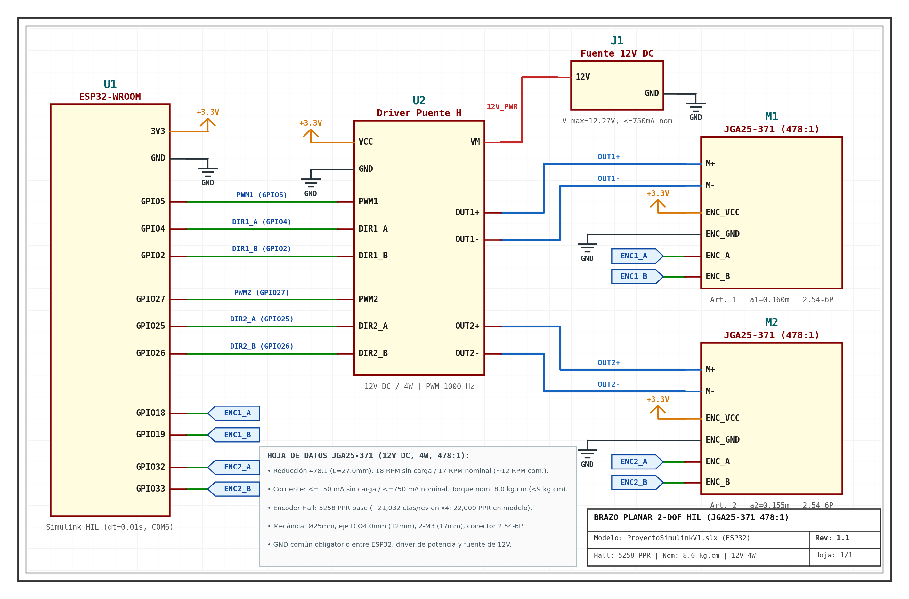

# 🤖 Brazo Planar 2-DOF — Control HIL con Simulink y ESP32

Modelo en **Simulink** (`simulink/ProyectoSimulinkV1.slx`) configurado para **ESP32-WROOM** (`dt = 0.01 s`, PWM a `1000 Hz`) junto con los modelos 3D (`.stl`) y el esquemático de referencia del montaje físico.

## 📂 Estructura del proyecto

* `simulink/ProyectoSimulinkV1.slx`: Modelo HIL completo con lectura de encoders en cuadratura, salidas PWM/dirección y bloque embebido `ControladorRobot`.
* `cad/`: Modelos 3D (`.stl`) de los eslabones y piezas mecánicas del manipulador.
* `docs/esquematico.png`: Esquemático de conexión de referencia entre ESP32, puente H y motorreductores.

## 🏗️ Arquitectura del Modelo (`ProyectoSimulinkV1.slx`)

El modelo opera en tiempo discreto (`FixedStepDiscrete`) con paso de muestreo `dt = 0.01 s` sobre **ESP32-WROOM**:

* **Realimentación de posición:** Dos bloques `Encoder` (`GPIO18/19` y `GPIO32/33`) capturan las cuentas en cuadratura sin reinicio y alimentan al bloque `ControladorRobot` para estimar posición y velocidad articular.
* **Lógica de control (`ControladorRobot`):** Bloque `MATLAB Function` que recibe `cuentas1`, `cuentas2`, `modo`, `q1_d`, `q2_d`, `x_d`, `y_d` y `Ejecutar`, generando `pwm1`, `dir1_A`, `dir1_B`, `pwm2`, `dir2_A`, `dir2_B`, `q1_deseado` y `q2_deseado`.
* **Actuación y monitoreo:** Envía PWM a `1000 Hz` (`GPIO5` y `GPIO27`) y señales de dirección (`GPIO4, 2, 25, 26`) al driver, mientras muestra posición deseada vs. real en grados en los bloques `Scope` (`Articulacion 1` y `Articulacion 2`).

## 🎮 Qué poner para mover el brazo

1. **Habilitar la consigna (`Ejecutar = 1`):** El bloque retiene las metas en memoria persistente cuando `Ejecutar == 0` y actualiza `meta_q1`, `meta_q2`, `meta_x`, `meta_y` cuando `Ejecutar == 1`.
2. **Seleccionar `modo` y metas:**
   * **`modo = 1` o `modo = 3` (Articular):** Define `q1_d` y `q2_d` en grados (el modelo convierte a radianes antes de entrar al bloque). `modo = 3` activa compensación de gravedad ($g = 9.81\text{ m/s}^2$).
   * **`modo = 2` o `modo = 4` (Operacional):** Define `x_d` y `y_d` en metros dentro del espacio de trabajo (`a1 = 0.160 m`, `a2 = 0.155 m`). `modo = 4` activa compensación de gravedad ($g = 9.81\text{ m/s}^2$).
3. **Energía y comunicación:** Verifica el puerto `COM` del ESP32, la alimentación de potencia (`~12 V`, $V_{\max} = 12.27\text{ V}$) y el **GND común** antes de iniciar la ejecución.

## 🧠 Estrategias de Control (`ControladorRobot`)

El bloque `ControladorRobot` implementa control **PD con compensación de gravedad** en dos espacios de trabajo, seleccionables mediante la entrada `modo` (la gravedad $g = 9.81\text{ m/s}^2$ se activa cuando `modo == 3` o `modo == 4`):

1. **Control en Espacio Articular (`modo == 1` o `modo == 3`):**

   $$\tau = K_p e - K_d \dot{q} + g(q)$$

   * **Ganancias:** $K_p = \mathrm{diag}(0.09, 0.16)$, $K_d = \mathrm{diag}(0.04, 0.03)$.
   * **Zona muerta:** $|e_i| < 0.055\text{ rad}$ para evitar vibraciones en estado estacionario.

2. **Control en Espacio Operacional / Cartesiano (`modo == 2` o `modo == 4`):**

   $$\tau = J(q)^T \left( K_{p,\text{op}} e_x - K_{d,\text{op}} J(q) \dot{q} \right) + g(q)$$

   * Calcula la cinemática inversa en configuración de **codo abajo** a partir de $(x_d, y_d)$ y mapea las fuerzas cartesianas mediante el Jacobiano transpuesto $J(q)^T$.
   * **Ganancias:** $K_{p,\text{op}} = \mathrm{diag}(4.0, 3.5)$, $K_{d,\text{op}} = \mathrm{diag}(0.6, 0.6)$.
   * **Zona muerta:** $\|e_x\| < 0.015\text{ m}$ ($1.5\text{ cm}$).

3. **Etapa de Actuación (Torque a Voltaje / PWM):**

   $$V_{\text{req}} = \frac{\tau}{K_t} R + K_e \dot{q}$$

   * Parámetros del modelo electromecánico: $R = 8.5\ \Omega$, $K_t = 0.012$, $K_e = 0.012$, saturado a $V_{\max} = 12.27\text{ V}$ y escalado a resolución PWM de `0–255` (`1000 Hz`).

## ⚙️ Especificaciones de los Actuadores (Hoja de Datos)

Motorreductor DC **JGA25-371** con encoder Hall (variante de bajas RPM / reducción `478:1`):

| Parámetro | Valor |
| :--- | :--- |
| **Voltaje / Potencia** | `12 V DC` / `4 W` |
| **Relación de reducción** | `478:1` (`L = 27.0 mm`) |
| **Velocidad (sin carga / nominal)** | `18 RPM` / `17 RPM` *(listado comercialmente como 12 RPM)* |
| **Corriente (sin carga / nominal)** | `≤ 150 mA` / `≤ 750 mA` |
| **Torque nominal / Límite máximo** | `8.0 kg·cm` / `< 9.0 kg·cm` *(no exceder 9 kg·cm)* |
| **Resolución encoder Hall** | `5258 PPR` base (`~21,032` cuentas/rev en cuadratura x4; `22000` en modelo) |
| **Dimensiones mecánicas** | Ø `25 mm`, eje tipo D Ø `4.0 mm` (`12 mm` largo), montaje `2-M3` (`17 mm`), conector `2.54-6P` |

## 🛠️ Requisitos y Conexiones

* **Software:** MATLAB y Simulink con soporte para hardware ESP32/Arduino (`arduinolib`, `arduinosensorlib` y *Coder Target*).
* **Pines en ESP32-WROOM:**
  * **Motor 1:** `PWM1` → `GPIO5`, `DIR1_A` → `GPIO4`, `DIR1_B` → `GPIO2`, `Encoder 1` → `GPIO18 / GPIO19`
  * **Motor 2:** `PWM2` → `GPIO27`, `DIR2_A` → `GPIO25`, `DIR2_B` → `GPIO26`, `Encoder 2` → `GPIO32 / GPIO33`
* **Parámetros físicos en el modelo:** `a1 = 0.160 m`, `a2 = 0.155 m`, `m1 = 0.181 kg`, `m2 = 0.064 kg`, `dt = 0.01 s`.

## 🚀 Uso rápido

1. Clona el repositorio y abre `simulink/ProyectoSimulinkV1.slx` en **MATLAB / Simulink**.
2. Selecciona el puerto serie (`COM`) de tu ESP32 y verifica el **GND común** entre fuente, driver y microcontrolador antes de energizar.
3. Compila y ejecuta el modelo (`Build, load and run` o *External Mode*).
